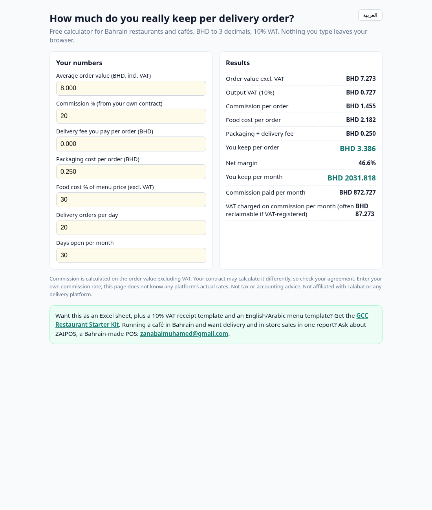
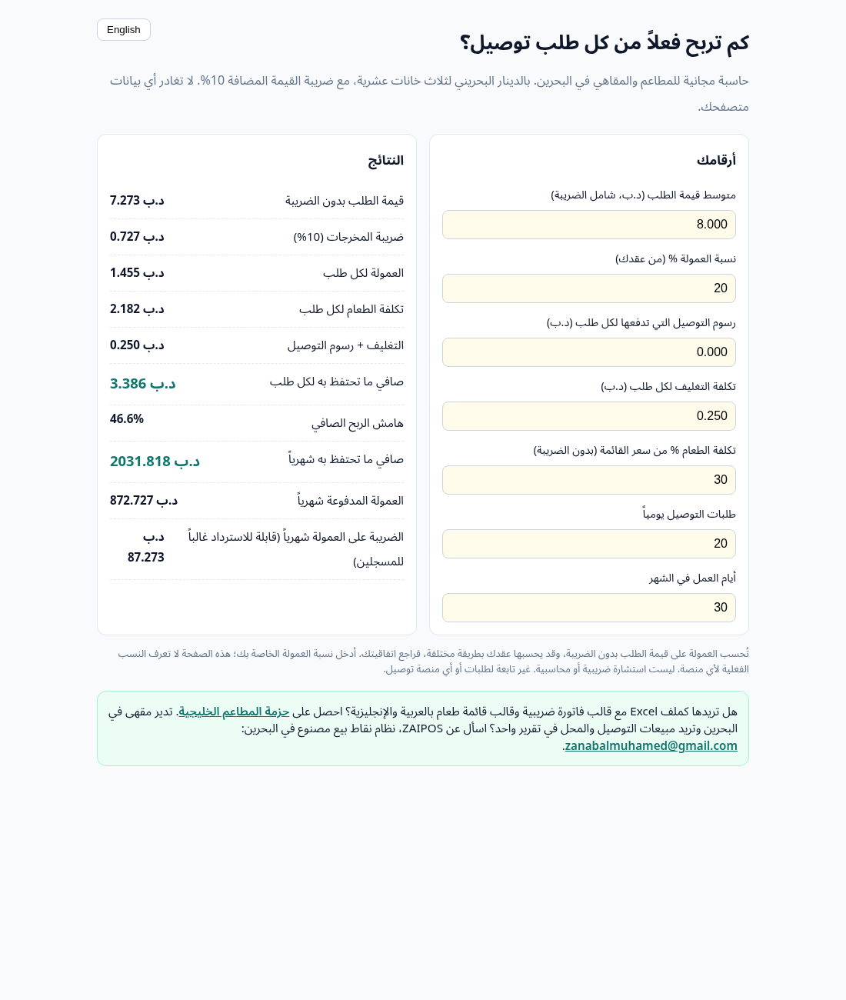

# Bahrain Delivery-App Calculator

Free, single-page calculator for restaurants and cafés in Bahrain. It shows what you actually keep from each delivery-app order after commission, delivery fee, packaging, food cost and 10% VAT. BHD to 3 decimals, English and Arabic.

Live: https://muhamedzanabal.github.io/bahrain-delivery-calculator/

- Runs entirely in your browser; no data is collected or sent anywhere.
- Enter your own commission rate from your contract; the page does not know any platform's actual rates.
- Not tax or accounting advice. Not affiliated with Talabat or any delivery platform.

